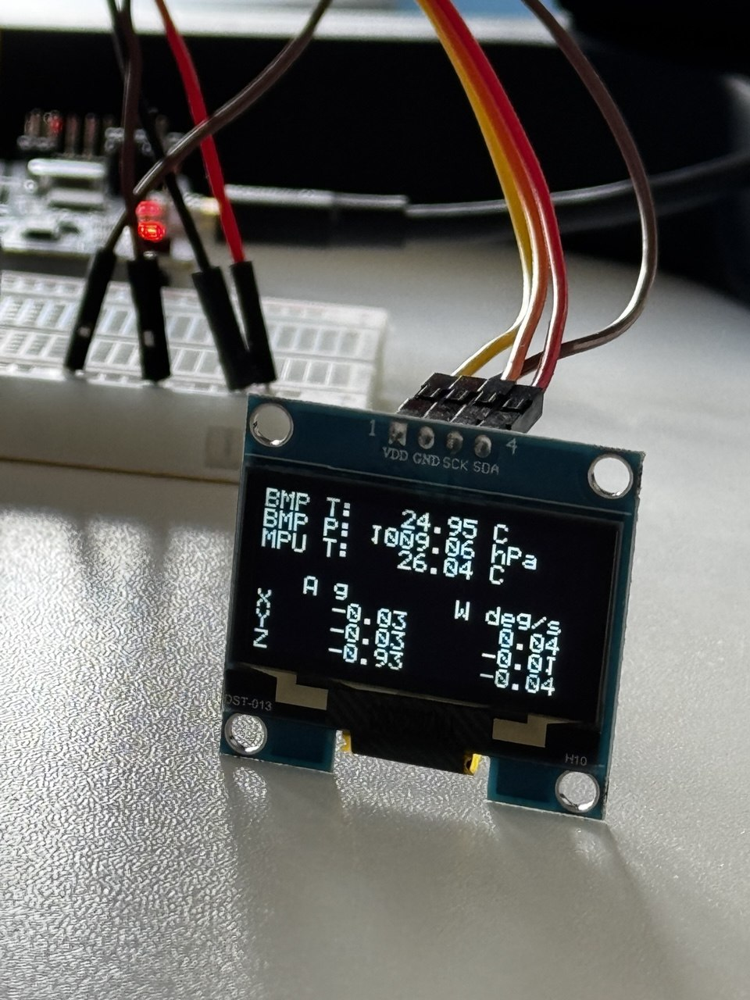

# STM32 Sensor Hub

STM32 Sensor Hub is a C++20 embedded firmware project for the NUCLEO-F401RE.
It combines direct peripheral register access, FreeRTOS, sensor drivers, and
OLED graphics without STM32 HAL, CubeMX, or Arduino.

The project targets the STM32F401RE ARM Cortex-M4F, with hardware floating-point
support, 512 KiB Flash, and 96 KiB SRAM.

## Features

The codebase includes:

- FreeRTOS with the GCC Cortex-M4F port and statically allocated tasks.
- I²C1 communication, device scanning, and bus recovery.
- BMP280 temperature and pressure acquisition with compensation.
- MPU6050 acceleration, temperature, angular velocity, and gyroscope calibration.
- SH1106 OLED framebuffer, text rendering, numeric formatting, and sensor dashboard.
- USART2 with interrupt-driven RX, buffered DMA TX, and error recovery support.
- Native unit tests for sensor logic, formatting, buffers, and USART2 DMA behavior.

**Current runtime:** the FreeRTOS application runs an LED heartbeat task that
toggles PA5 every second and sends one startup message over USART2. Sensor
acquisition, OLED updates, telemetry, and interactive console commands are not
active. Their drivers and application functions are included in the source tree.

The image below illustrates the dashboard rendering supported by the codebase;
it is not displayed by the current heartbeat application.



## Hardware

- NUCLEO-F401RE with integrated ST-LINK debugger and Virtual COM Port.
- BMP280 temperature and pressure sensor.
- MPU6050 motion sensor.
- 1.30-inch SH1106 128×64 I²C OLED display.
- USB cable, breadboard, and jumper wires.

The board alone is sufficient to run the heartbeat application.

### I²C wiring

BMP280, MPU6050, and SH1106 share I²C1. Use 3.3 V power and logic with a common
ground.

| Nucleo pin | MCU pin | Signal | BMP280 | MPU6050 | OLED |
|------------|---------|--------|--------|---------|------|
| `3V3` | — | Power | `VCC` | `VCC` | `VDD` |
| `GND` | — | Ground | `GND` | `GND` | `GND` |
| `D15` | `PB8` | I²C1 SCL | `SCL` | `SCL` | `SCK` |
| `D14` | `PB9` | I²C1 SDA | `SDA` | `SDA` | `SDA` |

The OLED module labels its I²C clock pin `SCK`.

| Device | Address configuration | 7-bit address |
|--------|-----------------------|---------------|
| BMP280 | `CSB` to 3.3 V, `SDO` to GND | `0x76` |
| MPU6050 | `AD0` to GND | `0x68` |
| SH1106 | Module configured for this address | `0x3C` |

USART2 uses PA2 (TX) and PA3 (RX), connected to the ST-LINK Virtual COM Port on
the board. The onboard LED uses PA5.

## Software Architecture

The firmware separates application behavior from device drivers and register
access:

```text
Application / FreeRTOS tasks
            |
Sensor drivers, graphics, diagnostics
            |
Peripheral drivers (I²C1, USART2, DMA)
            |
MCU definitions and memory-mapped registers
```

`src/main.cpp` initializes hardware and starts the scheduler. FreeRTOS owns
SysTick. Kernel configuration and callbacks are separate from peripheral
drivers. The application module exposes sensor initialization, sample
acquisition, telemetry, display, and command handling functions.

```text
Stm32SensorHub/
├── cmake/              ARM toolchain and pinned FreeRTOS dependency
├── config/             FreeRTOS configuration
├── docs/images/        Project images
├── include/            Headers organized by software layer
├── linker/             STM32F401RE memory layout
├── openocd/            Board flashing configuration
├── src/
│   ├── application/    Sensor hub application functions
│   ├── diagnostics/    I²C scanner
│   ├── drivers/        Peripheral, sensor, and OLED drivers
│   ├── graphics/       Text, formatting, and dashboard rendering
│   ├── sensors/        Sensor compensation algorithms
│   ├── system/         FreeRTOS callbacks and runtime support
│   └── main.cpp        Hardware initialization and heartbeat task
├── startup/            Cortex-M4 startup and vector table
├── tests/              Native GoogleTest suite and hardware substitutes
└── CMakeLists.txt
```

## Building

### Prerequisites

- CMake 3.28 or newer and Ninja.
- ARM GNU toolchain: `arm-none-eabi-gcc`, `arm-none-eabi-g++`,
  `arm-none-eabi-objcopy`, and `arm-none-eabi-size`, including newlib/nano libraries.
- Git and network access for the initial FreeRTOS download.
- OpenOCD for flashing; picocom or another serial terminal for serial output.

FreeRTOS-Kernel V11.1.0 is pinned to commit
`dbf70559b27d39c1fdb68dfb9a32140b6a6777a0` in `cmake/freertos.cmake` and fetched
by CMake.

Run from the repository root:

```bash
cmake -S . -B build -G Ninja \
    -DCMAKE_TOOLCHAIN_FILE=cmake/arm-none-eabi-toolchain.cmake \
    -DCMAKE_BUILD_TYPE=Debug
cmake --build build
```

Generated firmware files:

```text
build/stm32_sensor_hub.elf
build/stm32_sensor_hub.bin
build/stm32_sensor_hub.hex
```

The build reports Flash and RAM usage. To inspect the ELF size separately:

```bash
arm-none-eabi-size build/stm32_sensor_hub.elf
```

## Flashing

Connect the board through its ST-LINK USB connector, then run:

```bash
openocd -f openocd/nucleo-f401re.cfg \
    -c "program build/stm32_sensor_hub.elf verify reset exit"
```

The onboard LED should toggle every second, producing a full on/off cycle every
two seconds.

## Serial Console

Open the ST-LINK Virtual COM Port using 115200 baud, 8 data bits, no parity,
one stop bit, and no flow control:

```bash
picocom --baud 115200 /dev/ttyACM0
```

Adjust the device path to match your system. With the terminal open, press the
board's RESET button to see the startup message:

```text
Stm32SensorHub FreeRTOS starting
```

The current application sends no periodic output and does not process console
commands or echo input. Exit picocom with `Ctrl+A`, then `Ctrl+X`.

## Testing

Native tests require a host C++20 compiler and GoogleTest. They use a separate
build directory and do not require the board or ARM toolchain.

```bash
cmake -S tests -B build-tests -G Ninja
cmake --build build-tests
ctest --test-dir build-tests --output-on-failure
```

Tests cover sensor decoding and compensation, sensor-driver I²C interactions,
number formatting, ring buffers, and USART2 DMA transmission and recovery.
Host hardware substitutes do not simulate physical bus timing or FreeRTOS
context switching.
